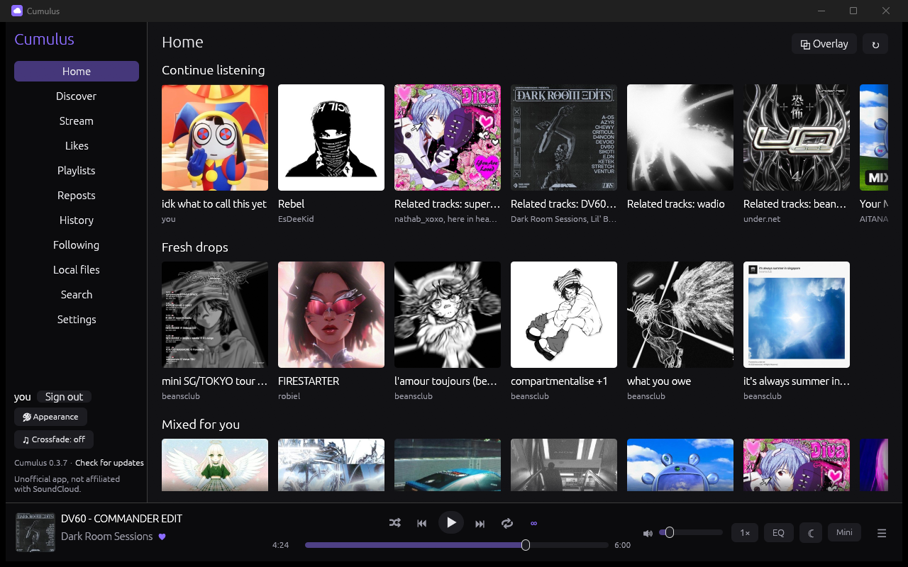
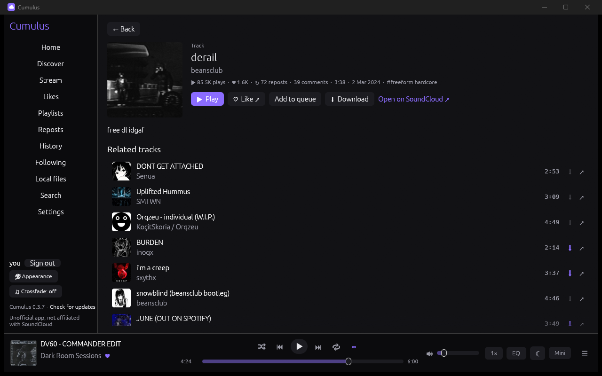
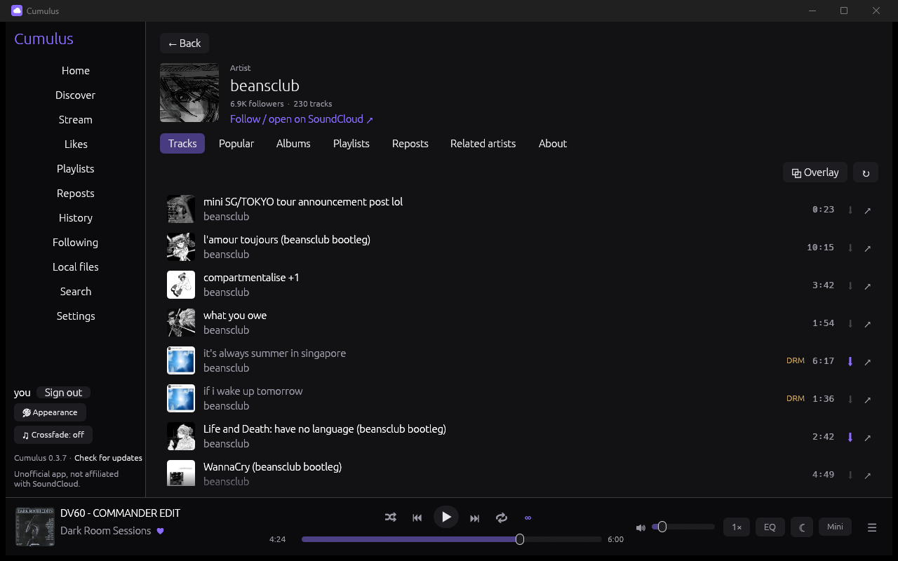
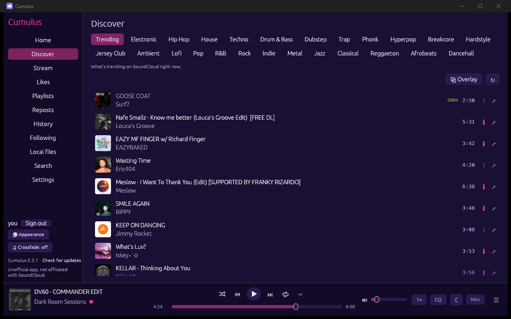
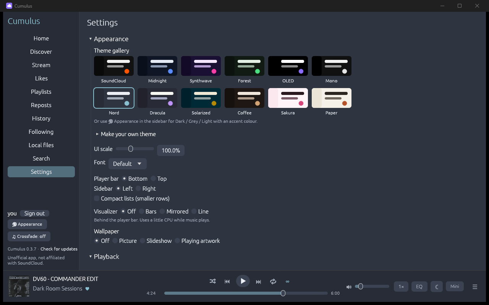
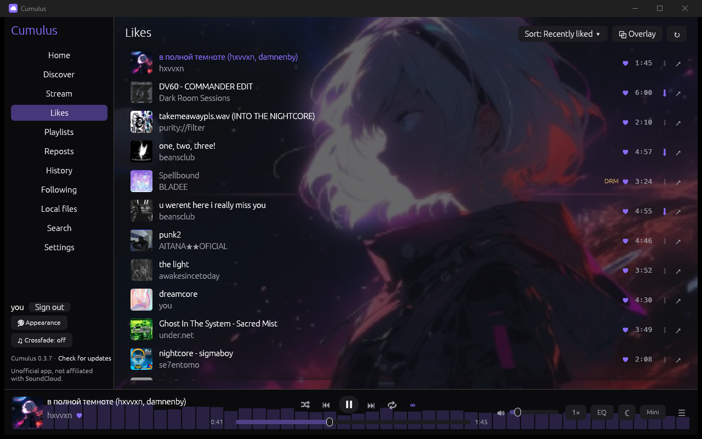

# Cumulus

A lightweight native desktop player for your SoundCloud library: Rust + egui,
native audio, no bundled browser. **Unofficial; not affiliated with SoundCloud.**



| | |
|---|---|
|  |  |
| **Track pages:** stats, related tracks, and the playlists a track is in | **Artist pages** with tabs, bio and links |
|  |  |
| **Discover:** trending, or browse 24 genres (Synthwave theme) | **Settings:** theme gallery, scale, fonts, layout, wallpapers (Nord theme) |


*The playing song's cover as wallpaper, with the visualizer behind the player bar.*

## Install (Windows 10 / 11)

You don't need any programming tools for this.

1. Go to the **[latest release](https://github.com/Pvff13/cumulus/releases/latest)**
   and click the **`cumulus_…_x64-setup.exe`** file under *Assets* to download it.
2. Open the downloaded file. Windows will probably show a blue box saying
   **"Windows protected your PC"**, because this small free app isn't
   paid-for "code signed". Click **More info**, then **Run anyway**.
3. Click through the installer (*Next* / *Install* / *Finish*). It installs
   just for you, so it won't ask for an administrator password.
4. Open **Cumulus** from the Start menu and click **Sign in with
   SoundCloud**. Sign in on SoundCloud's own page (email and password works
   best); the window closes by itself when you're done.

To uninstall: Windows **Settings → Apps → Installed apps → Cumulus →
Uninstall**.

Good to know: Cumulus is unofficial and uses the same behind-the-scenes
connection as the soundcloud.com website, so a change on SoundCloud's side can
break it until it's fixed, and using it is against SoundCloud's API terms
(see below).

**Updates:** from version 0.2.0 on, Cumulus checks GitHub for a new release
(at start-up and every few hours; or click **Check for updates** at the bottom
of the sidebar to check right away). When there is one, it downloads it, checks
its digital signature, and an **Update to …** button appears at the bottom of
the sidebar. One click and it restarts on the new version. If you have
0.1.0, download the newest release once by hand.

## How it talks to SoundCloud

SoundCloud only issues official API keys to Artist Pro subscribers, so Cumulus
uses the same web API the soundcloud.com website uses (`api-v2.soundcloud.com`).
This is against SoundCloud's API terms. It works for personal use, but
SoundCloud can change it at any time or act on accounts that use it. All of
that code lives in `src/api/` so changes stay contained.

Cumulus still keeps to the rules that matter: streams are never saved or
ripped (the only downloads are files artists choose to offer), no attempt to
play blocked/preview-only/DRM tracks,
and every track credits its artist and links back to SoundCloud.

## Sign-in

- **Sign in with SoundCloud** opens SoundCloud's own sign-in page in a small
  window (the system WebView2). You sign in there yourself; once the site has
  set its `oauth_token` cookie the window saves it and closes. The window runs
  as a separate process, so its memory is fully released afterwards.
- The token is stored in **Windows Credential Manager** (entry `Cumulus`).
  Nothing secret is written to disk by Cumulus itself.
- **Paste a token instead** is a fallback: paste the value of the
  `oauth_token` cookie from soundcloud.com (browser dev tools → Application →
  Cookies).
- The website's public `client_id` is discovered automatically from
  soundcloud.com and cached in `%LOCALAPPDATA%\Cumulus\config.json`. When
  SoundCloud rotates it, Cumulus picks up the new one by itself.

## Library browsing

- **Home** (the start view) mirrors soundcloud.com's home page: your
  personal mixes ("Mixed for …", Your Mix 1-n) and *Made for you* (Daily
  Drops, Weekly Wave) first, then More of what you like, Recently Played,
  stations, trending and recommended albums. **Recently Played** shows the
  songs you actually played (each with its own cover; click to play, right-
  click for the track menu) instead of SoundCloud's repeated station tiles. Hover a mix and click the ▶ in
  the middle to play it, or click the tile or its title to open it. The mix
  that's playing keeps a ⏸ on its tile to pause/resume it. Rows scroll sideways (Shift + wheel or the
  scrollbar).
- **Stream, Likes, Playlists, Reposts** in the sidebar. Lists are virtualised:
  only the rows on screen are laid out, and the next page of 50 loads when you
  scroll near the end. ↻ refreshes a list.
- **Playlists** open in place. SoundCloud only returns the first 5 tracks of a
  playlist in full; the rest are fetched in batches of 50 as they scroll into
  view.
- Every row credits the uploader (click the name to open their profile) and
  has a ↗ link to the track or playlist on soundcloud.com. Tracks that are
  geo-blocked or preview-only (Go+) are marked.

## Playback

- Hover a track and click ▶ on its artwork, or double-click the row. The rest
  of that list becomes the queue (playlists included, even the parts not
  loaded yet).
- Bottom bar: shuffle, previous, play/pause, next, repeat (off / all / one),
  ∞ autoplay, seek bar and volume. The title opens the track's page; the
  artist links to SoundCloud.
- **Resume where you left off:** the queue, the track and the position come
  back (paused) the next time you open Cumulus.
- **Sleep timer** (☾ in the player bar): 15-90 minutes or the end of the
  track. It fades out, then pauses.
- **Equalizer** (EQ): five bands plus a preamp, with presets (Bass boost,
  Vocal, Electronic, Late night...). Changes are heard instantly.
- **Playback speed** (1×): Slowed, Normal and Nightcore, or anything from
  0.5× to 2×. Pitch follows speed, like a record.
- **Paste a SoundCloud link** into Search to open that track, playlist,
  album or artist. Short on.soundcloud.com links work too.
- **Keyboard:** Space, ←/→ (seek), ↑/↓ (volume), Ctrl+←/→ (previous/next),
  M, S, R, L, Ctrl+F or /, Alt+←/→ (back/forward), Shift+< / Shift+> (speed).
  All of them can be changed in Settings.
- **Track pages:** click any track's title (or "Track details" in its
  right-click menu) for a page like soundcloud.com's: artwork, plays, likes,
  reposts, comments, release date, genre and description; Play, Like, Add to
  queue, Download (when offered); then **Related tracks** (play one and the
  list becomes the queue), **In albums** and **In playlists** (20 at a time,
  with Show more).
- **Autoplay** (∞, on by default): when the last track of whatever you're
  playing starts, Cumulus adds up to 20 similar tracks (SoundCloud's "related
  tracks", skipping ones already queued) so the music carries on without a
  gap. Turn it off to stop at the end of the list.
- Keyboard: **Space** play/pause, **←/→** seek 5 s, **↑/↓** volume, **/** search.
- **Gapless-ish:** the next track is opened about 30 s before the current one
  ends, and its audio is appended straight after the current track's audio.
- **Crossfade and transitions:** **♫ Crossfade** (bottom of the sidebar) sets
  a 1–12 s crossfade for tracks that follow on by themselves (skipping is
  still instant). The **Transitions** dropdown picks the style: **Smooth**
  (even loudness), **Linear**, **Fade out, then in**, **Filter sweep (bass
  swap)** or **Echo out**. Two extra options:
  - **Trim silence** (on by default) skips silence at the end and start of
    tracks, so transitions happen over music;
  - **Match volume** evens out loudness between tracks (within ±6 dB).

  Both use a short background scan of each track.
- **Formats:** plain HLS AAC (160 kbps when your account gets it, else 96),
  else progressive MP3. Decoding happens natively (symphonia); Windows'
  own audio stack does any resampling.
- **Skipped, with a message:** geo-blocked tracks and Go+ preview-only tracks.
- **DRM-protected tracks** (many label releases are only sent encrypted, and
  only SoundCloud's own site and apps hold the keys) are tagged **DRM** and
  dimmed in every list. Clicking one opens it on soundcloud.com, where it
  plays. Queues skip them straight away without trying, so a mix with a few
  of them just plays past. After 5 failures in a row (e.g. offline) playback stops
  instead of skipping through the whole list.
- **Downloads:** every track shows a **⬇**. It's in the accent colour when the
  artist offers a download. Click it to save SoundCloud's original file to your
  Downloads folder, or to open the artist's own "free download"/buy link
  (Hypeddit, Bandcamp...). A faint ⬇ means the artist doesn't offer one;
  clicking it opens the track on SoundCloud. Also in the right-click menu.

## Now-playing pop-out (for streaming)

**⧉ Overlay** (next to ↻ at the top of Home and the lists) → **Show pop-out
window** opens a small window with the current song's cover, title, artist
and progress. It keeps updating while Cumulus is minimised or in the tray.

- **Show controls:** previous, play/pause, next and volume on the pop-out.
- **Always on top:** keep it above other windows.
- Both are in the ⧉ menu and when you right-click the pop-out. Your choices
  are remembered, including whether the pop-out was open. It's off until you
  turn it on.
- **In OBS:** add a **Window Capture** source and pick
  `[cumulus.exe]: Cumulus - Now playing`. Turn controls off for a clean card
  on stream.

## Appearance

**🎨 Appearance** (bottom of the sidebar) picks a **Dark**, **Grey** or
**Light** theme and one of 12 accent colours (purple, blue, sky, teal, green,
lime, yellow, orange, red, pink, magenta, silver). Changes apply instantly and
are remembered. On the light theme, bright accents are darkened a little so
they stay readable.

**Settings → Appearance** has more:
- **Theme gallery:** SoundCloud, Midnight, Synthwave, Forest, OLED, Mono,
  Nord, Dracula, Solarized, Coffee, Sakura and Paper.
- **Make your own theme:** pick every colour. **Copy as text** shares a
  theme; anyone can paste it back in with **Use it**.
- UI scale (70–150 %), the main font, player bar on top or bottom, sidebar
  left or right, and compact lists.
- **Wallpaper:** a picture, a slideshow from a folder, or the playing song's
  cover, behind the page with adjustable dimming.
- **Visualizer** behind the player bar: bars, mirrored or line.

## More to explore

- **Discover:** SoundCloud's trending chart, plus 24 genres to browse by
  tracks, albums, artists or playlists.
- **History** (what you played) and **Following** (who you follow) in the
  sidebar.
- **Home** adds **Continue listening** (playlists, albums and mixes you
  played lately) and **Fresh drops** (new uploads from people you follow,
  past two weeks).
- **Likes** can be sorted by title, artist, length or plays. Picking a sort
  loads every like first.
- **Artist pages** have tabs: Tracks, Popular, Albums, Playlists, Reposts,
  Related artists, and About (bio and social links).
- **Hiding:** right-click a track → **Not interested** or **Block artist**,
  or add keywords in Settings. They're hidden everywhere, including autoplay.

## Local files

**Local files** in the sidebar plays music on your PC: MP3, M4A/AAC, FLAC,
WAV, AIFF, OGG Vorbis and ALAC.
- **Add music:** add folders (subfolders included) or single files, or drag
  them onto the window.
- **Tags:** titles, artists, albums and covers come from the files' tags,
  with `cover.jpg` / `folder.jpg` as a fallback.
- **Faster rescans:** the library is cached, so a rescan only reads files
  that changed.
- **Local playlists:** they can mix your files with SoundCloud tracks
  (right-click any track → **Add to local playlist**). They're saved on this
  PC only and aren't uploaded anywhere.

## Settings

- **Playback:**
  - output device;
  - stream quality (160 kbps AAC when available, or lighter 96–128 kbps);
  - skip a track that gets stuck.
- **System:** start with Windows (opens hidden in the tray), and close to
  tray.
- **Keyboard:** every shortcut can be changed with a key recorder.
  Play/pause, next, previous, volume, mute and like can also get **global**
  keys that work while another app is in front.
- **Integrations:**
  - Discord status ("Listening to Cumulus" with the song, artist and
    cover; needs the Discord desktop app);
  - scrobbling to **Last.fm** and **ListenBrainz** (after half a track or 4
    minutes; logins are kept in Windows' credential store);
  - for OBS, a now-playing **text file** and a local **browser overlay**
    (`http://127.0.0.1:8337/`, add `?hidepaused=1` to hide it while paused).
- **Hiding:** keywords, blocked artists and "not interested" tracks, each
  with undo.
- **Mini player** (button in the player bar): just a small, always-on-top
  pop-out with controls. ⤢ goes back to the full window.

## Queue, search, likes, playlists

- **Queue** (☰ in the player bar): what's playing and what's next. Drag
  entries to reorder, ✕ to remove, double-click to jump. Right-click any
  track → *Play next* / *Add to queue*.
- **Search** (sidebar, or press **/**): Tracks, People, Playlists and Albums
  tabs; it searches as you type. Clicking a person, or an artist's name on
  any track, shows their uploads in the app (with a link to their SoundCloud
  page).
- **Likes and playlists are read-only in the app.** ♥ marks tracks you've
  liked. Clicking a heart, or right-click → *Like / Add to playlist on
  SoundCloud ↗*, opens the track on soundcloud.com in your browser so you can
  do it there. When you switch back to Cumulus it re-reads your likes (and
  refreshes the Likes or Playlists list).

  Why: SoundCloud puts every account change behind a DataDome bot check
  (tested: liking returned a CAPTCHA challenge). Cumulus doesn't try to get
  around that, so it never writes to your account at all.

## Desktop integration

- **Media keys and the Windows media overlay** (SMTC): play/pause, next,
  previous and seeking from the keyboard, the volume flyout or the lock
  screen, showing the track's title, artist, artwork and timeline.
- **Tray icon:** left-click shows or hides the window; right-click gives
  Play/Pause, Next, Previous and Quit, and the tooltip shows what's playing.
- **Close to tray:** the window's ✕ hides Cumulus to the tray and the music
  keeps playing. Use *Quit* in the tray menu to exit. Untick *Close to tray,
  keep playing* (bottom of the sidebar) to make ✕ quit instead.

## Caching

All under `%LOCALAPPDATA%\Cumulus\cache`, safe to delete at any time:

- `art/`: artwork thumbnails, capped at 100 MB by default (`art_cache_mb` in
  `config.json`); least recently used files are removed first. Only about
  16 MB of decoded artwork is kept in memory, and big images (500 px mix
  tiles) are shrunk to 300 px when loaded.
- `meta/`: the first page of each list and the home page as raw JSON (capped at 20 MB), so the
  app shows your library instantly on start-up and while offline.
- Audio is never cached or saved.

## Build

Requirements (Windows): Rust (via `rustup`) and Visual Studio Build Tools with
the "Desktop development with C++" workload. WebView2 is built into Windows 11.

```bash
cargo build --release
```

The binary is `target/release/cumulus.exe` (about 9.6 MB).

### Updates

**From GitHub (everyone).** Every few hours Cumulus asks GitHub for the
latest release. If it's newer, it downloads that release's `cumulus.exe` and
`cumulus.exe.sig` and checks the signature against the public key built into
the app (`src/signing.rs`). The signature covers the version number and the
exe's SHA-256, so a tampered file, a different file or an older release
passed off as new is rejected and nothing is written. Only a verified update
is saved, and only a click on **Update to …** installs it (same swap as below).

**From the build folder (the maintainer's own copy).** An installed Cumulus
also updates itself from this project's build folder: after
`cargo build --release`, the running app notices the newer
`target/release/cumulus.exe` (at start-up and every 10 minutes) and shows
**Restart to update** in the sidebar. Clicking it swaps in the new exe
(Windows allows renaming a running .exe, so the old one is moved aside and
deleted on the next start) and restarts; settings and sign-in are kept. It
never restarts on its own. Each build carries a build number (`cumulus.exe
--build-id`) so it only ever moves forward. To update from a different
location, set `update_source` in `config.json` to the path of a
`cumulus.exe`. Debug builds don't update.

### Windows installer

```bash
cargo install cargo-packager --locked
cargo packager --release
```

For a public download, build with `CUMULUS_PUBLIC_BUILD=1` (no built-in
local update path) and remap your user folder out of the binary, e.g.
`CARGO_ENCODED_RUSTFLAGS="--remap-path-prefix=C:\Users\<you>=~"`, ideally
with a separate `CARGO_TARGET_DIR`.

This builds `dist/cumulus_<version>_x64-setup.exe` (about 4.5 MB, NSIS). It
installs per-user (no admin prompt) to `%LOCALAPPDATA%\Cumulus`, adds a
Start-menu entry and an *Apps & features* entry with an uninstaller.
Uninstalling removes the program but keeps your settings and caches in the
same folder; delete the folder to remove those too. The installer isn't
code-signed, so Windows SmartScreen will warn the first time ("More info" →
"Run anyway"). On Windows 10, sign-in needs the WebView2 runtime (most PCs
already have it via Edge).

The icon in `assets/` is drawn in code; regenerate it with
`cargo run -- --dev-icon assets`. `build.rs` embeds `assets/icon.ico` into the
exe (that's what Explorer, shortcuts and the taskbar show).

Tests: `cargo test` (offline) and `cargo test -- --ignored` (hits SoundCloud).

### Making a release

1. Bump `version` in `Cargo.toml`, then commit.
2. Build the public installer (see above). That produces
   `target/public/release/cumulus.exe` and `dist/cumulus_<ver>_x64-setup.exe`.
3. Sign the exe with the private key (kept **outside** the repo, e.g.
   `%APPDATA%\Cumulus-release\release.key`; back it up, because without it no
   further updates can be signed):
   `cargo run -- --dev-sign <key> target/public/release/cumulus.exe <ver> > cumulus.exe.sig`
4. Create a GitHub release tagged `v<ver>` with three files: the installer,
   `cumulus.exe` and `cumulus.exe.sig`.

`cargo run -- --dev-keygen <path>` creates a new key pair (only needed once)
and prints the public key for `RELEASE_KEY` in `src/signing.rs`.

## Dependencies

| Crate | Why |
|---|---|
| `eframe`/`egui` (glow) | Native UI. Only repaints on input. OpenGL measured far lighter here than wgpu (64 MB / 0% CPU vs 200 MB / 2.5%). |
| `wry` + `winit` | Sign-in window only, using the OS webview. |
| `keyring` | OS credential store. |
| `ureq` (native-tls) | Small blocking HTTP client on worker threads, using Windows' own TLS. |
| `serde`, `serde_json`, `dirs` | JSON and the per-user data folder. |
| `image` (jpeg, png only) | Decoding artwork. |
| `symphonia-core`, `-codec-aac`, `-bundle-mp3` | Pure-Rust AAC and MP3 decoding. The HLS playlist and fragmented-MP4 parsing are small hand-written modules (`src/player/hls.rs`, `fmp4.rs`). |
| `cpal` | Audio output via WASAPI, opened at the track's sample rate so Windows resamples (no resampler dependency). |
| `souvlaki` | Windows media overlay / media keys (also MPRIS and macOS Now Playing). |
| `tray-icon` | Tray icon and its menu. |
| `embed-resource` (build only) | Compiles the icon into the .exe with the Windows SDK's `rc.exe`. Not part of the app at runtime. |
| `ed25519-dalek`, `sha2` | Checking update signatures (and, in debug builds only, signing releases). |
| `getrandom` | Creating the signing key (debug-only tool). |
| `raw-window-handle` | Hands the window handle to the media controls. |
| `memmap2` | Memory-maps Windows' own fonts (Segoe UI Symbol, CJK, emoji...) as fallbacks for the decorative Unicode common in track names, without loading them into RAM. |

## Performance (measured)

Optimized build, measured on this machine (6 cores, Windows 11, NVIDIA GPU)
on 2026-10-16, playing the same track in both cases. The browser figures are
Chrome 155.0.8059.85 with a fresh, empty profile (no extensions), summed over all of
its processes, because that's the real cost of keeping a tab open.

| | RAM (working set) | Private memory | CPU (all cores) | Processes |
|---|---|---|---|---|
| **Cumulus**, idle, library showing | ~76 MB | ~74 MB | 0.00% | 1 |
| **Cumulus**, playing, window visible | ~97 MB | ~88 MB | 0.9% | 1 |
| **Cumulus**, playing, minimised | ~97 MB | ~88 MB | 0.08% | 1 |
| **Cumulus**, playing, hidden in tray | ~102 MB | ~93 MB | 0.12% | 1 |
| SoundCloud in Chrome, tab open, not playing | ~766 MB | ~485 MB | 3.2% | 9 |
| SoundCloud in Chrome, playing | ~890–950 MB | ~570–620 MB | 6.5–7.6% | 10–11 |

So while playing, Cumulus uses roughly **9× less memory** (by working set;
about 6× by private memory) and **7–80× less CPU** than a SoundCloud tab,
depending on whether the window is visible. Working-set sums for Chrome
slightly overcount shared pages, which is why private memory is shown too.

Binary about 9.6 MB; installer about 4.5 MB.

## License

MIT, see [LICENSE](LICENSE). This covers Cumulus's own code only; it grants
nothing over SoundCloud's service, API or content, which remain subject to
SoundCloud's terms.
